**DevOps Group 8 – Population Reporting System**

**Build Status**

[](https://github.com/aungyekhant333-crypto/DevOps_Group8/actions/workflows/main.yml)

**Master Branch**

[](https://github.com/aungyekhant333-crypto/DevOps_Group8/actions/workflows/main.yml?query=branch%3Amaster)

**Develop branch:**

[](https://github.com/aungyekhant333-crypto/DevOps_Group8/actions/workflows/main.yml?query=branch%3Adevelop)

[](https://github.com/aungyekhant333-crypto/DevOps_Group8/blob/master/LICENSE)

[](https://github.com/aungyekhant333-crypto/DevOps_Group8/releases)

**Module:** SET09803 DevOps
**Project:** Population Reporting System
**Language:** Java

## Contents

1. [Project Overview](#1-project-overview)
2. [Project Objectives](#2-project-objectives)
3. [Main Features](#3-main-features)
4. [Technology Stack](#4-technology-stack)
5. [Prerequisites](#5-prerequisites)
6. [Getting the Project](#6-getting-the-project)
7. [Database Setup](#7-database-setup)
8. [Build and Run](#8-build-and-run)
9. [Docker](#9-docker)
10. [Testing and Continuous Integration](#10-testing-and-continuous-integration)
11. [Coursework Requirements Checklist](#11-coursework-requirements-checklist)
12. [Team Members and Contributions](#12-team-members-and-contributions)
13. [Repository Links](#13-repository-links)
14. [Data, Assumptions and Limitations](#14-data-assumptions-and-limitations)
15. [Acknowledgements and License](#15-acknowledgements-and-licence)

## 1. Project Overview

The Population Reporting System is a group software development project created for the SET09803 DevOps module. It uses the supplied SQL `world` database to retrieve and display population information about countries, cities, capital cities, geographical areas and languages.

Users can view reports for different geographical levels, including the world, continents, regions, countries, districts and cities. Depending on the report, results can be displayed as a complete list, a population ranking, a total, or a population distribution.

The project also gives the team an opportunity to practise DevOps activities, including source control with Git and GitHub, collaborative development, automated building, testing and containerisation.

## 2. Project Objectives

The main objectives are to:

- Implement and verify the 32 population-reporting requirements in the coursework specification.
- Present report results in a clear and consistent format.
- Sort population rankings from the largest population to the smallest where required.
- Allow users to request reports for supported geographical areas.
- Support top-N reports, where the user specifies how many results to display.
- Calculate population totals and urban/non-urban population figures and percentages.
- Report speaker statistics for Chinese, English, Hindi, Spanish and Arabic.
- Use GitHub to manage source code and team collaboration.
- Use Maven and GitHub Actions to support repeatable builds and automated checks.
- Provide Docker configuration where supported by the repository.

## 3. Main Features

The system is intended to provide the following report categories, subject to implementation and testing:

- **Country reports:** list and rank countries worldwide or by continent and region.
- **City reports:** list and rank cities worldwide or by continent, region, country and district.
- **Capital city reports:** list and rank capital cities worldwide or by continent and region.
- **Population distribution:** report total, urban and non-urban population figures and percentages for continents, regions and countries.
- **Population totals:** report totals for the world, continents, regions, countries, districts and cities.
- **Language statistics:** report speaker figures for Chinese, English, Hindi, Spanish and Arabic, including the required ranking and percentages.
- **Top-N reports:** allow users to request a specified number of results where required.

## 4. Technology Stack

| Technology          | Purpose                                                                                             |
|---------------------|-----------------------------------------------------------------------------------------------------|
| Java                | Implements the population reporting application.                                                    |
| Apache Maven        | Manages the build and packages the application.                                                     |
| MariaDB JDBC driver | Connects the Java application to a compatible SQL database.                                         |
| MySQL/MariaDB       | Stores the `world` population dataset.                                                              |
| Git                 | Tracks source-code changes.                                                                         |
| GitHub              | Hosts the repository and supports team collaboration.                                               |
| GitHub Actions      | Runs the automated workflow configured in the repository.                                           |
| Docker              | Builds and runs the application in a container when the required Docker configuration is available. |

**Java version:** The current project configuration targets Java 25. Check `pom.xml` and `.github/workflows/main.yml` if the team changes the required version.

## 5. Prerequisites

Before setting up the project, install or prepare:

1. **JDK 25** – required to compile and run the current project configuration.
2. **Apache Maven** – used to build and package the Java application.
3. **Git** – used to clone the repository and manage source-code changes.
4. **MySQL or MariaDB** – a compatible database server for the supplied `world` dataset.
5. **Docker Desktop or Docker Engine** – needed only if you want to build and run the container.
6. **A code editor or IDE** – for example, IntelliJ IDEA, Eclipse or Visual Studio Code.

Check the installation from a terminal:

```bash
java -version
mvn -version
git --version
docker --version
```

The Docker command is optional if Docker is not installed. Make sure the Java version reported by your environment matches the version configured by the project.

## 6. Getting the Project

### Step 1: Clone the repository

Open a terminal and run:

```bash
git clone https://github.com/aungyekhant333-crypto/DevOps_Group8.git
```

### Step 2: Enter the project folder

```bash
cd DevOps_Group8
```

### Step 3: Check the project files

Confirm that the repository contains the Maven `pom.xml` file. The project may also contain source code, database initialisation files, Docker configuration and GitHub Actions workflows.

If a command below reports that a file or folder does not exist, check the repository structure before continuing. Do not create replacement configuration files without first checking the existing project.

## 7. Database Setup

The application needs access to the supplied `world` database before it can retrieve population reports.

### Step 1: Locate the SQL file

The expected database initialisation file is:

`docker/mysql/init/world.sql`

Check that this file exists in your local repository. It should contain the SQL statements used to create and populate the database.

### Step 2: Start the database server

Start your local MySQL or MariaDB service. Confirm the server is running and note the host, port, username and password needed to connect.

### Step 3: Import the database

If the SQL file creates the `world` database itself, run the following command from the project root, adjusting the username and connection settings for your environment:

```bash
mysql -u YOUR_DB_USER -p < docker/mysql/init/world.sql
```

Enter your database password when prompted. If your database client uses a different command or connection method, use the equivalent import process for your installation.

### Step 4: Check the database

Connect to the database and confirm that the `world` schema and its tables have been created. Check that the expected country, city and population data is present.

### Step 5: Configure the application connection

Check the source code and configuration files to find how the application receives its database connection details. Set the database host, port, schema, username and password using the configuration method actually implemented in the project.

The exact configuration keys must match the application code. Do not assume that a particular `.env` file, properties file or environment variable is supported unless it is implemented.

**Security note:** Do not commit database passwords, access tokens or other private credentials to GitHub.

## 8. Build and Run

### Step 1: Build the application

From the project root, run:

```bash
mvn clean package
```

Maven cleans previous build output, compiles the source code, runs any tests configured for the build and packages the application.

If the build fails, read the first relevant error in the terminal. Check the Java version, dependencies, database-independent compilation errors and Maven configuration before trying again.

### Step 2: Locate the packaged JAR

After a successful build, check the `target` directory. The current Maven configuration is expected to produce:

```text
target/DevOps_Group8-1.0-SNAPSHOT-jar-with-dependencies.jar
```

The filename can change if the project version or Maven configuration changes. Use the actual JAR filename shown in `target`.

### Step 3: Run the application

If the executable JAR exists at the expected path, run:

```bash
java -jar target/DevOps_Group8-1.0-SNAPSHOT-jar-with-dependencies.jar
```

The application must be able to connect to the configured database. Follow the prompts or interface provided by the implementation to select a report and supply any required values, such as a geographical area or top-N limit.

If the application cannot connect, check that the database server is running, the `world` schema exists, and the connection settings match your environment.

## 9. Docker

Use this section only if the repository contains a working `Dockerfile` and any required container configuration.

Check that Docker is installed and running:

```bash
docker --version
docker ps
```

From the directory containing the `Dockerfile`, build the image:

```bash
docker build -t devopsimage .
```

Run the container:

```bash
docker run --name devopscontainer devopsimage
```

These are basic examples. The actual project may require environment variables, ports, a Docker network or Docker Compose configuration. Follow the repository's existing configuration rather than assuming these commands are sufficient. If the database runs in another container, `localhost` inside the application container does not refer to that database container.

## 10. Testing and Continuous Integration

### 10.1 Run tests

```bash
mvn test
```

This runs the tests configured in Maven. If no relevant tests exist, a successful command does not prove that the reports work correctly. Test sorting, top-N limits, geographical filters, totals, percentages, invalid input, database errors and all five language statistics.

### 10.2 Verify the build

```bash
mvn clean verify
```

This runs the Maven verification lifecycle and any checks configured in the project.

### 10.3 GitHub Actions

The workflow is expected at `.github/workflows/main.yml`. Check the actual file and workflow results here: [GitHub Actions – DevOps Group 8](https://github.com/aungyekhant333-crypto/DevOps_Group8/actions). A successful workflow only confirms that its configured steps passed; it does not automatically prove all 32 requirements have been tested.

## 11. Coursework Requirements Checklist

The following checklist follows the requirement numbering in ascending order. Tick a requirement only after the relevant feature has been implemented and checked. Add a screenshot or other suitable evidence where required by the assessment.

| ID | Requirement                                                                                                                               | Verified | Evidence                                                                                                                                                      |
|---:|-------------------------------------------------------------------------------------------------------------------------------------------|:--------:|---------------------------------------------------------------------------------------------------------------------------------------------------------------|
|  1 | List all countries in the world, ordered from largest population to smallest.                                                             | [ Yes ]  | 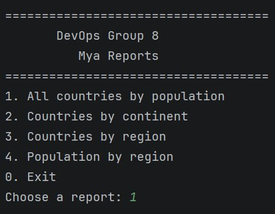<br/>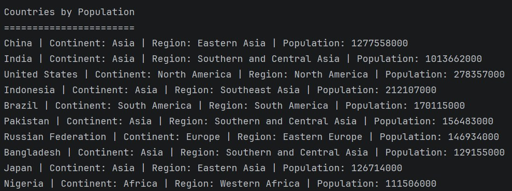 |
|  2 | List all countries in a selected continent, ordered from largest population to smallest.                                                  | [ Yes ]  | 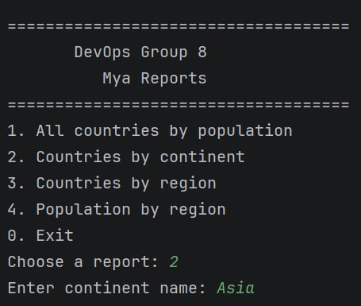 <br/>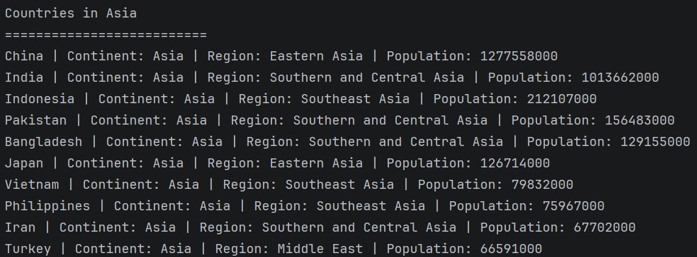                    |
|  3 | List all countries in a selected region, ordered from largest population to smallest.                                                     | [ Yes ]  | 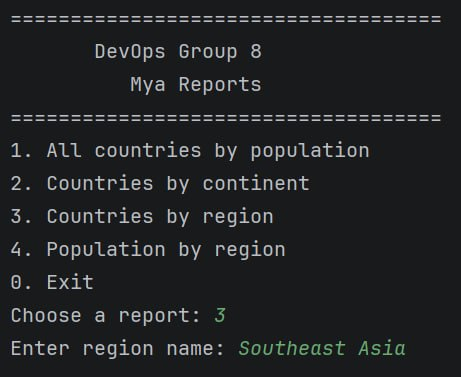   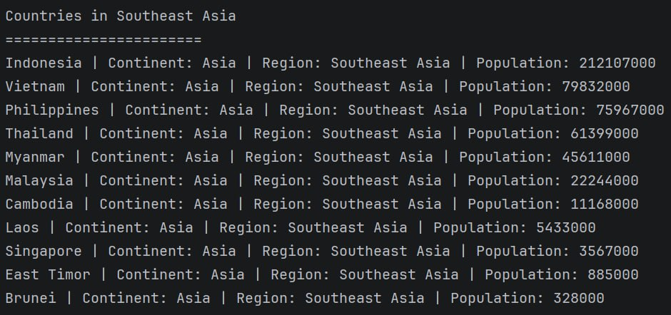                                   |
|  4 | Show the top N most populated countries in the world, where N is provided by the user.                                                    | [ Yes ]  | 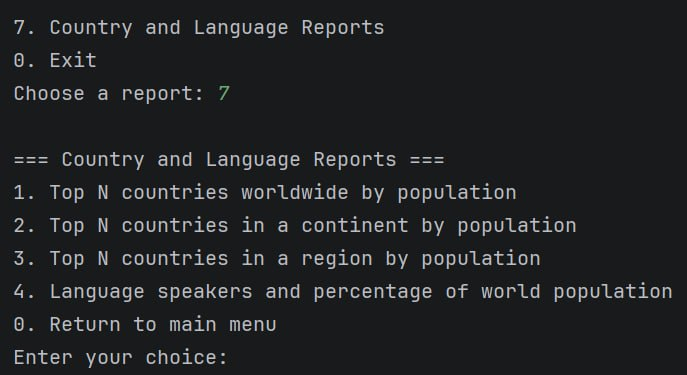  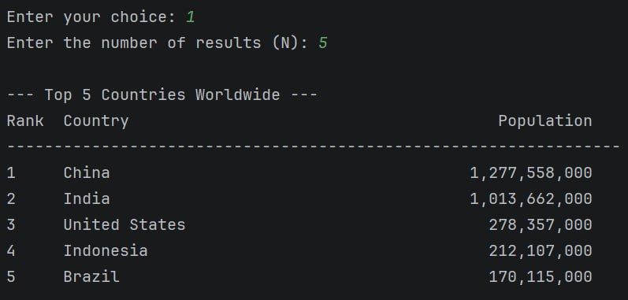                                                                                  |
|  5 | Show the top N most populated countries in a selected continent.                                                                          | [ Yes ]  | 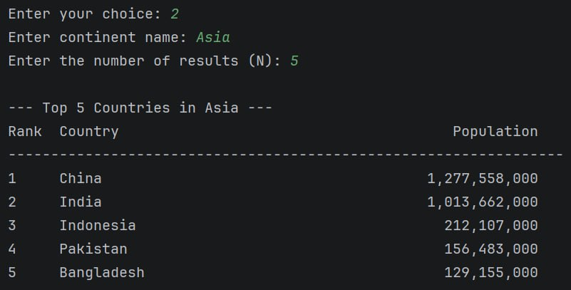                                                                                                  |
|  6 | Show the top N most populated countries in a selected region.                                                                             | [ Yes ]  | 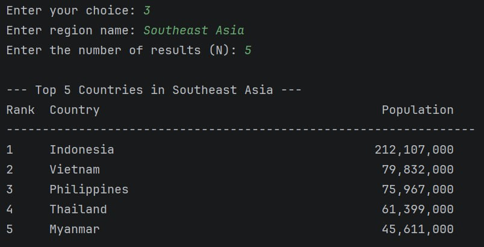                                                                              |
|  7 | List all cities in the world, ordered from largest population to smallest.                                                                | [ Yes ]  | 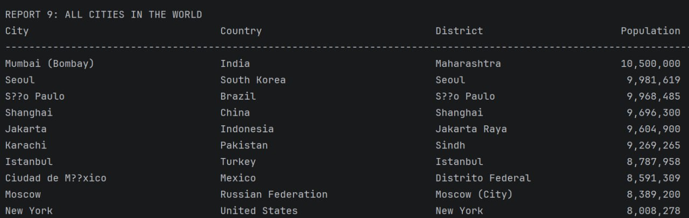                                                                                                  |
|  8 | List all cities in a selected continent, ordered from largest population to smallest.                                                     | [ Yes ]  | 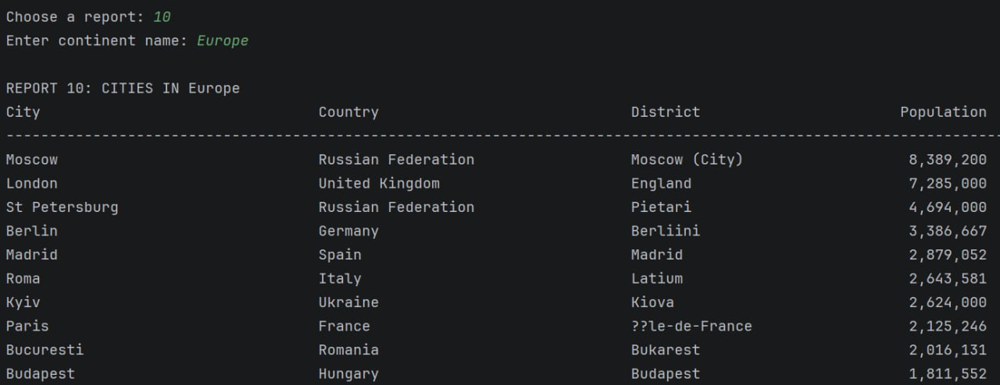                                                                                                    |
|  9 | List all cities in a selected region, ordered from largest population to smallest.                                                        | [ Yes ]  | 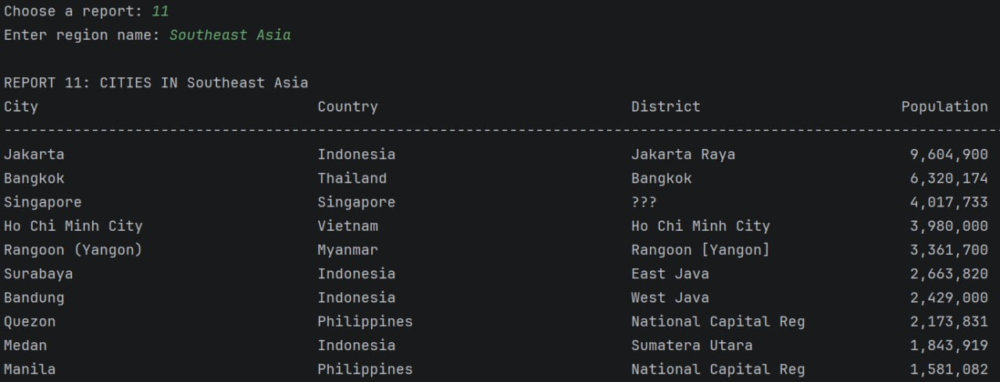                                                                                                          |
| 10 | List all cities in a selected country, ordered from largest population to smallest.                                                       | [ Yes ]  | 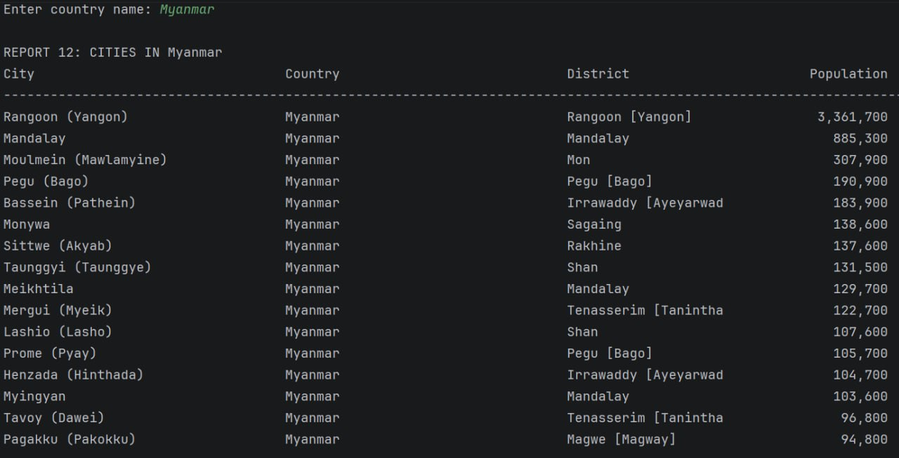                                                                                                        |
| 11 | List all cities in a selected district, ordered from largest population to smallest.                                                      | [ Yes ]  | 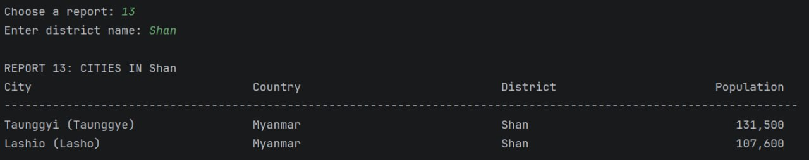                                                                                                      |
| 12 | Show the top N most populated cities in the world.                                                                                        | [ Yes ]  |                                                                                         |
| 13 | Show the top N most populated cities in a selected continent.                                                                             | [ Yes ]  |                                                                                                   |
| 14 | Show the top N most populated cities in a selected region.                                                                                | [ Yes ]  |                                                                               |
| 15 | Show the top N most populated cities in a selected country.                                                                               |   [ ]    | To add                                                                                                                                                        |
| 16 | Show the top N most populated cities in a selected district.                                                                              |   [ ]    | To add                                                                                                                                                        |
| 17 | List all capital cities in the world, ordered from largest population to smallest.                                                        |   [ ]    | To add                                                                                                                                                        |
| 18 | List all capital cities in a selected continent, ordered from largest population to smallest.                                             |   [ ]    | To add                                                                                                                                                        |
| 19 | List all capital cities in a selected region, ordered from largest population to smallest.                                                |   [ ]    | To add                                                                                                                                                        |
| 20 | Show the top N most populated capital cities in the world.                                                                                |   [ ]    | To add                                                                                                                                                        |
| 21 | Show the top N most populated capital cities in a selected continent.                                                                     |   [ ]    | To add                                                                                                                                                        |
| 22 | Show the top N most populated capital cities in a selected region.                                                                        |   [ ]    | To add                                                                                                                                                        |
| 23 | Report total, urban and non-urban population figures and percentages for each continent.                                                  |   [ ]    | To add                                                                                                                                                        |
| 24 | Report total, urban and non-urban population figures and percentages for each region.                                                     |   [ ]    | To add                                                                                                                                                        |
| 25 | Report total, urban and non-urban population figures and percentages for each country.                                                    |   [ ]    | To add                                                                                                                                                        |
| 26 | Report the total population of the world.                                                                                                 | [ Yes ]  | 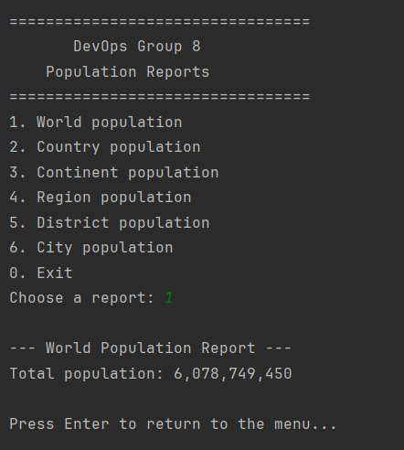                                                                                            |
| 27 | Report the total population of a selected continent.                                                                                      | [ Yes ]  | 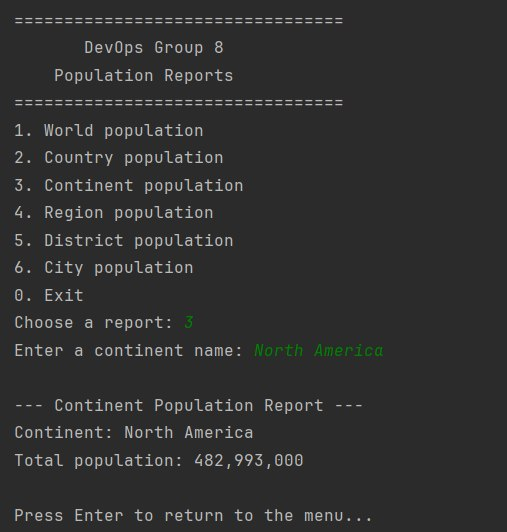                                                                                                          |
| 28 | Report the total population of a selected region.                                                                                         | [ Yes ]  | 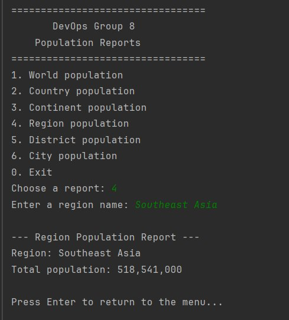                                                                                                                |
| 29 | Report the total population of a selected country.                                                                                        | [ Yes ]  | 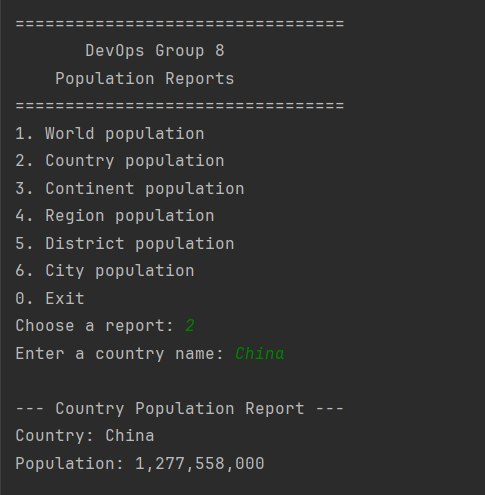                                                                                                              |
| 30 | Report the total population of a selected district.                                                                                       | [ Yes ]  | 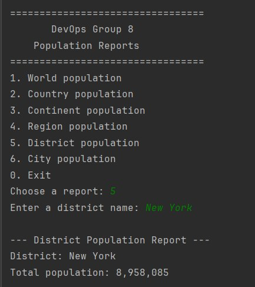                                                                                                            |
| 31 | Report the total population of a selected city.                                                                                           | [ Yes ]  | 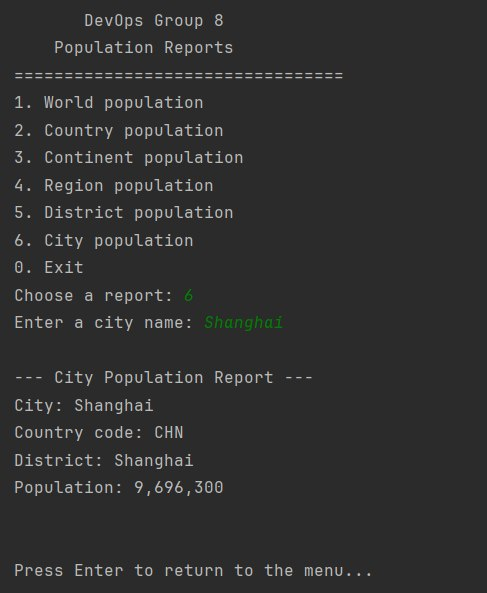                                                                                                                    |
| 32 | Report the number of speakers of Chinese, English, Hindi, Spanish and Arabic, with the required ranking and world-population percentages. | [ Yes  ] | 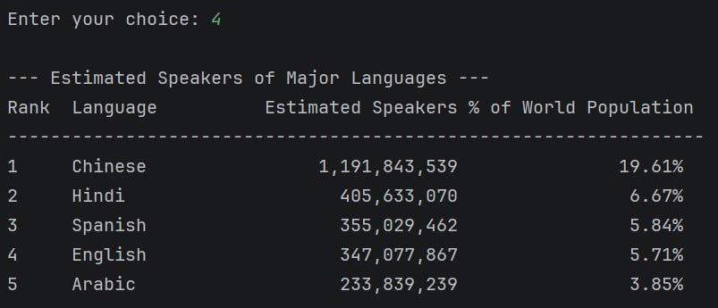                                                                                    |

**Completion percentage:**


## 12. Code Review 1 – Team Roles and Contributions

The following table records the team roles and work completed for Code Review 1. The tasks listed reflect the team's contributions at this review stage and should not be treated as proof that every coursework requirement has passed testing.

| Matric number | Team member         | Role          | Tasks completed for Code Review 1                                                             |
|---------------|---------------------|---------------|-----------------------------------------------------------------------------------------------|
| 40858560      | Mya Hmue Khin       | Product Owner | Produced four reports and reviewed the team's code.                                           |
| 40858555      | Aung Ye Khant       | Scrum Master  | Produced four reports, including shared report tasks; created the repository and Scrum board. |
| 40858648      | Hsu Lae Wai         | Member 1      | Produced six reports and shared responsibility for two reports.                               |
| 40858600      | Ye Ko Ko Lwin       | Member 2      | Shared responsibility for four reports.                                                       |
| 40858647      | Yoon Phyu Phyu Aung | Member 3      | Shared responsibility for two reports; created the use case diagram and documentation.        |
| 40858665      | Khine Su Thwal      | Member 4      | Produced six reports, including shared responsibility for three reports.                      |


## 13. Repository Links

- **Source code:** [DevOps Group 8 repository](https://github.com/aungyekhant333-crypto/DevOps_Group8)
- **Automated builds:** [GitHub Actions](https://github.com/aungyekhant333-crypto/DevOps_Group8/actions)
- **Issues and tasks:** [GitHub Issues](https://github.com/aungyekhant333-crypto/DevOps_Group8/issues)
- **Releases:** [GitHub Releases](https://github.com/aungyekhant333-crypto/DevOps_Group8/releases)
- **Licence:** [`LICENSE`](LICENSE)
- **Database initialisation file:** [`docker/mysql/init/world.sql`](docker/mysql/init/world.sql)
- **Maven configuration:** [`pom.xml`](pom.xml)
- **CI workflow:** [`.github/workflows/main.yml`](.github/workflows/main.yml)

## 14. Data, Assumptions and Limitations

### Data source

The project uses the SQL population dataset supplied for the coursework. Confirm the dataset's original source, version and licence before submission, and provide attribution where required.

### Assumptions

- The database has been imported correctly and contains the required tables and data.
- Reports use the values stored in the supplied dataset.
- Geographical filters use names and values available in that dataset.
- Top-N input is a positive integer.
- Rankings and percentage calculations follow the coursework specification and the implemented logic.

### Limitations

- Results depend on the accuracy and completeness of the supplied data, which may not reflect current population figures.
- Missing database records may affect report results.
- Language speaker counts may overlap because a person can speak more than one language; they should not be treated as counts of unique people.
- Available functionality depends on what has actually been implemented and tested.

## 15. Acknowledgements and Licence

The team acknowledges the SET09803 teaching team for the coursework specification and the supplied population database. Any third-party libraries, datasets, documentation or other resources used in the project should be acknowledged in accordance with their applicable licence and attribution requirements.

