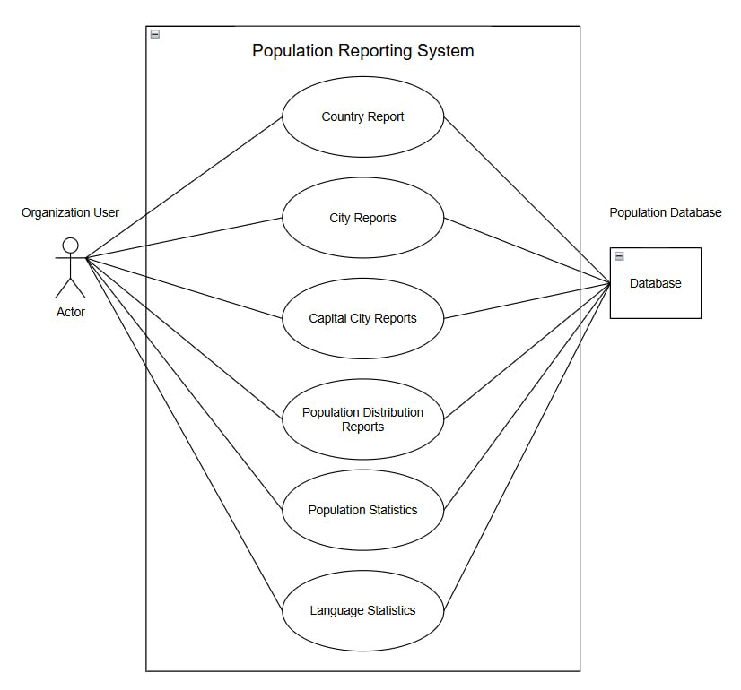

# Use Case Diagram and Definitions

## 1. Overview

The Population Reporting System retrieves and presents population-related information from the World database. It allows an organisation user to access reports about countries, cities, capital cities, population distribution, population statistics, and language statistics.

This document presents the use case diagram and defines the system's principal use cases.

## 2. Use Case Diagram

**Figure 1:** Use case diagram for the Population Reporting System.

## 3. Actors

### 3.1 Organisation User

The Organisation User is the primary actor who interacts with the Population Reporting System to request and view population-related reports. The user selects the required report and provides any necessary parameters, such as a country, continent, region, district, or number of results.

### 3.2 Population Database

The Population Database stores the country, city, population, and language information used to generate reports. It provides the data retrieved by the reporting system.

*Note: If the database is an internal component of the Population Reporting System, it should normally be represented as a system component rather than an external actor in the diagram.*

## 4. Use Case Definitions

### UC01 — Country Reports

**Primary actor:** Organisation User

**Description:** Retrieves country information and presents countries in population order.

**Preconditions:**
- The Population Reporting System is available.
- The Population Database is accessible and contains the required data.

**Main flow:**
1. The Organisation User selects a country report.
2. The system retrieves the relevant country and population data.
3. The system orders the countries by population, from largest to smallest.
4. The system displays the resulting report.

**Expected outcome:** The user receives a population-ranked country report. Reports may cover all countries worldwide, countries within a selected continent, or countries within a selected region.

### UC02 — City Reports

**Primary actor:** Organisation User

**Description:** Retrieves city information and presents cities according to population.

**Preconditions:**
- The database contains the required city and population information.

**Main flow:**
1. The user selects a city report.
2. The user specifies the required geographical scope or number of results, where applicable.
3. The system retrieves the matching city records.
4. The system orders the results by population, from largest to smallest.
5. The system displays the city report.

**Expected outcome:** The user receives a city population report matching the selected criteria.

### UC03 — Capital City Reports

**Primary actor:** Organisation User

**Description:** Retrieves information about capital cities from the database.

**Preconditions:**
- Capital-city records are available in the database.

**Main flow:**
1. The user selects a capital city report.
2. The system retrieves the relevant capital-city information.
3. The system processes the information according to the report requirements.
4. The system displays the results.

**Expected outcome:** The user can view the available capital-city information.

### UC04 — Population Distribution Reports

**Primary actor:** Organisation User

**Description:** Presents population distribution information, including urban and non-urban populations by region.

**Preconditions:**
- The database contains the population information required for the report.

**Main flow:**
1. The user selects a population distribution report.
2. The system retrieves the relevant regional population data.
3. The system identifies the total, urban, and non-urban population figures required by the report.
4. The system presents the figures for each relevant region.

**Expected outcome:** The user can compare total, urban, and non-urban populations across regions.

### UC05 — Population Statistics

**Primary actor:** Organisation User

**Description:** Retrieves and presents population statistics supported by the system.

**Preconditions:**
- The required population data is available in the database.

**Main flow:**
1. The user selects a population statistics report.
2. The system retrieves the relevant population records.
3. The system processes the data according to the selected report criteria.
4. The system displays the resulting statistics.

**Expected outcome:** The user receives population statistics for the requested scope.

### UC06 — Language Statistics

**Primary actor:** Organisation User

**Description:** Retrieves and presents language-related statistics stored in the database.

**Preconditions:**
- Relevant language records are available in the database.

**Main flow:**
1. The user selects a language statistics report.
2. The system retrieves the relevant language information.
3. The system processes the information according to the report requirements.
4. The system displays the available language statistics.

**Expected outcome:** The user can review language-related information supported by the database.

## 5. General Postconditions

- The requested report is displayed when the request succeeds.
- Report information is retrieved from the Population Database.
- The underlying database records are not modified by viewing a report.
- If the requested information cannot be retrieved, the system should report the problem rather than present incorrect results.

## 6. Scope and Limitations

The use cases describe the intended reporting functionality of the Population Reporting System. The exact report fields, sorting rules, and input parameters depend on the implemented application requirements.

Each use case should be checked against the corresponding user story and implementation before being considered complete. A use case shown in the diagram does not, by itself, prove that the functionality has already been implemented.